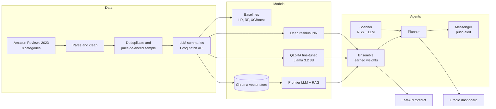

# Price Estimate

**Predict what a product costs from its text description, then use that predictor inside a team of AI agents that finds online deals selling well below their true value.**

[](https://github.com/hnjgp/price-estimate/actions/workflows/ci.yml)


This project goes through the full ML lifecycle on one problem: curating a dataset of ~800k Amazon products,
comparing classic ML with deep learning and frontier LLMs, fine-tuning an open-source LLM with QLoRA,
combining models in an ensemble, and deploying everything behind an agent system, a REST API and a web UI.

> **Origin.** The problem and the original notebooks come from the capstone ("The Price is Right") of
> Ed Donner's [LLM Engineering course](https://github.com/ed-donner/llm_engineering) (MIT licensed).
> This repository is my own re-implementation as a structured, tested Python package, with the
> changes listed in [What I changed](#what-i-changed). See [Credits](#credits).

---

## How it works



1. **Data.** Products from 8 Amazon categories priced between $0.50 and $999 are parsed, cleaned of part
   numbers and noise, deduplicated, and resampled so expensive items are not drowned out by cheap ones.
   A small LLM rewrites every description into the same short five-line format.
2. **Models.** The same test items are priced by a ladder of models, from a constant guess up to a
   frontier LLM given five similar products and their prices (RAG). A Llama 3.2 3B model is fine-tuned
   with QLoRA to output a price directly and is served on a Modal GPU.
3. **Ensemble.** The three strongest models are combined. Their weights are fitted on validation data
   with non-negative least squares instead of being picked by hand.
4. **Agents.** A scanner reads deal RSS feeds and uses structured output to pick the clearest deals.
   The ensemble estimates each one's real value, the planner picks the biggest discount, and the
   messenger sends a push notification. An autonomous variant lets the LLM drive these steps with tool calls.

## What I changed

Compared with the course notebooks, this version:

| Area | Change |
|---|---|
| Structure | One installable package (`src/price_estimate`) with scripts, instead of notebooks plus three copies of `items.py` and `evaluator.py` |
| Configuration | Usernames, model names and paths come from `.env` (`config.py`), nothing is hard-coded |
| Ensemble | Weights are **learned** (NNLS on validation predictions, `scripts/fit_ensemble.py`) instead of the fixed 0.8 / 0.1 / 0.1 |
| Reliability | If one ensemble member fails (API down, cold GPU), the others are re-weighted rather than the whole prediction failing |
| Neural network | Log-price mean and std are saved **in the checkpoint**. The original hard-coded them, so a retrained model would silently give wrong prices. Old weight files still load |
| Bugs fixed | Batch upload opened files as `open("rb", encoding=...)`, which raises `ValueError`. Malformed weights such as `"hundredths"` or `"1,200 Grams"` crashed the parser. The neural network loader defaulted to Apple's `mps` device, which fails on Windows and Linux |
| Agents | The autonomous planner has a turn limit and returns tool errors to the model. Logging handlers are no longer added again on every run. Corrupt memory files no longer crash startup. Web requests have timeouts |
| Evaluation | Works headless (no Jupyter). Reports MAE ± 95% CI, RMSE, RMSLE, R² and hit rate, survives individual API failures, and saves HTML charts |
| Serving | New **FastAPI** `/predict` endpoint and a **"Price a product"** tab in the dashboard |
| Fine-tuning | My own TRL `SFTTrainer` script with completion-only loss (the course did this step in Colab) |
| Quality | 60+ offline unit tests (fakes for every LLM/API), ruff, and GitHub Actions CI |

## Results

These are the reference numbers published with the course, measured on its 200-item test set. They
show the scale of the gap between approaches. **They are not my measurements.** Run
`scripts/benchmark.py` to produce your own table in `reports/benchmark.md`.

| Model | Mean absolute error |
|---|---|
| Constant (training mean) | $106 |
| Linear regression on 3 features | $102 |
| Bag-of-words + linear regression | $77 |
| Random forest | $72 |
| XGBoost | $68 |
| GPT-4.1 nano (zero-shot) | $63 |
| Deep residual neural network | $46 |
| GPT-5.1 (zero-shot) | $45 |
| Llama 3.2 3B, QLoRA fine-tuned (full data) | $40 |

The main lesson: a 3B open model fine-tuned on in-domain data can beat a much larger frontier model on
this narrow task, and a well-built neural network on bag-of-words gets close to both.

## Project structure

```
src/price_estimate/
  config.py              settings from environment / .env
  data/                  Item model, parser, loaders, sampling, LLM summarizer
  models/                baselines, deep NN, LLM + RAG, fine-tuned specialist, ensemble
  evaluation/            metrics and the evaluator
  rag.py                 Chroma vector store and similarity search
  agents/                scanner, planner, autonomous planner, messenger, framework
  app/                   FastAPI service and Gradio dashboard
scripts/                 build_dataset, summarize, train_dnn, build_vectorstore, fit_ensemble, benchmark
training/                prepare_prompts, finetune_qlora (GPU)
modal_services/          GPU inference service for the fine-tuned model
tests/                   offline test suite
```

## Quick start

```bash
git clone https://github.com/hnjgp/price-estimate.git
cd price-estimate
python -m venv .venv && source .venv/bin/activate      # Windows: .venv\Scripts\activate
pip install -e ".[all,dev]"
cp .env.example .env                                   # then add the keys you need
pytest -q                                              # no keys or GPU needed
```

You do not have to rebuild the dataset to start. By default the scripts read the curated dataset that was
published with the course (`DATA_HF_USER=ed-donner`). Set `MY_HF_USER` to publish your own.

```bash
python scripts/benchmark.py --size 200                 # classic baselines, no API keys
python scripts/train_dnn.py --epochs 5                 # GPU recommended
python scripts/build_vectorstore.py --limit 400000
python scripts/benchmark.py --dnn --rag --llm openai/gpt-4.1-nano
```

### Full pipeline from scratch

```bash
python scripts/build_dataset.py --push                 # ~800k items -> <you>/items_raw_full
python scripts/summarize.py submit                     # Groq batch jobs (resumable)
python scripts/summarize.py collect                    # repeat until all batches finish
python scripts/summarize.py push                       # -> <you>/items_full
python training/prepare_prompts.py                     # -> <you>/items_prompts_full
python training/finetune_qlora.py --push               # on a GPU, -> <you>/price-<timestamp>
ADAPTER_REPO=<you>/price-<timestamp> modal deploy modal_services/pricer_service.py
python scripts/fit_ensemble.py --size 200
```

### Run the agents

```bash
python -m price_estimate.agents.framework              # one deal-hunting cycle
python -m price_estimate.agents.framework --autonomous # LLM decides which tools to call
python -m price_estimate.app.ui                        # dashboard (runs every 5 minutes)
uvicorn price_estimate.app.api:app                     # REST API
curl -X POST localhost:8000/predict -H "content-type: application/json" \
     -d '{"description": "Shure MV7+ podcast microphone with USB-C and XLR outputs"}'
```

## Design decisions and limitations

- **Why log-price for the neural network:** prices span three orders of magnitude. Training on raw dollars
  lets expensive items dominate the loss; log space makes a 20% miss cost about the same at any price.
- **Why RAG helps the frontier model:** the LLM knows roughly what products cost, but five similar
  products with real prices anchor it to *this* dataset's price distribution.
- **Data leakage risk:** the RAG store is built from the training split only. Never index the test set.
- **Limitations:** prices are capped at $999, so the models cannot price expensive items. Amazon list
  prices from 2023 drift over time. Deal pages are scraped from HTML, which breaks if the site layout
  changes. The fine-tuned model needs a GPU service, which costs money when it is kept warm.

## Credits

- Problem framing, dataset design and original notebooks: **Ed Donner**,
  [LLM Engineering](https://github.com/ed-donner/llm_engineering) course, MIT License.
  His copyright notice is kept in [LICENSE](LICENSE). The default dataset and adapter used by the
  scripts are the ones he published on Hugging Face.
- Data: [Amazon Reviews 2023](https://amazon-reviews-2023.github.io/), McAuley Lab, UCSD.

## Author

**Hootan Seifi**, [GitHub @hnjgp](https://github.com/hnjgp)
